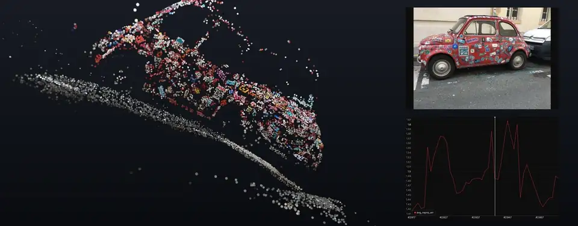
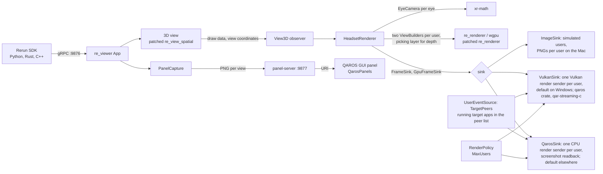
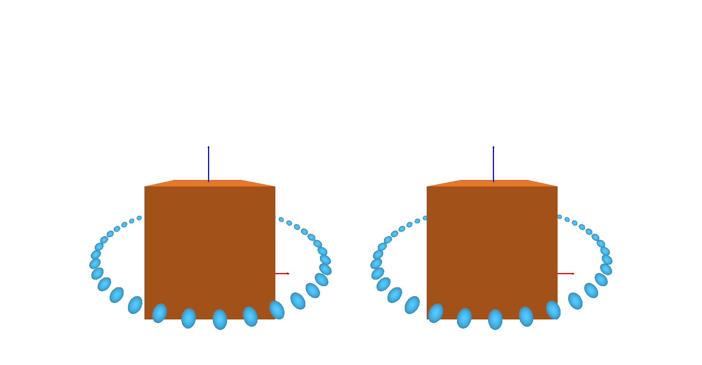
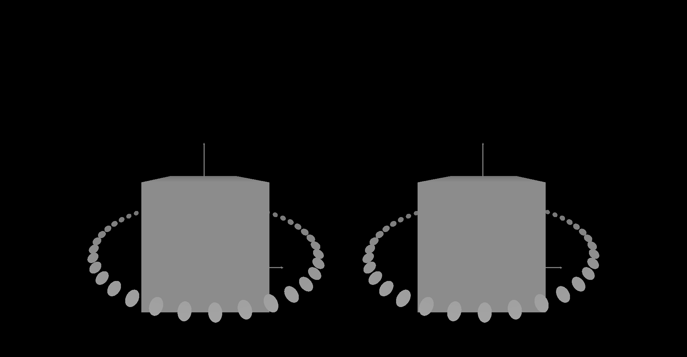
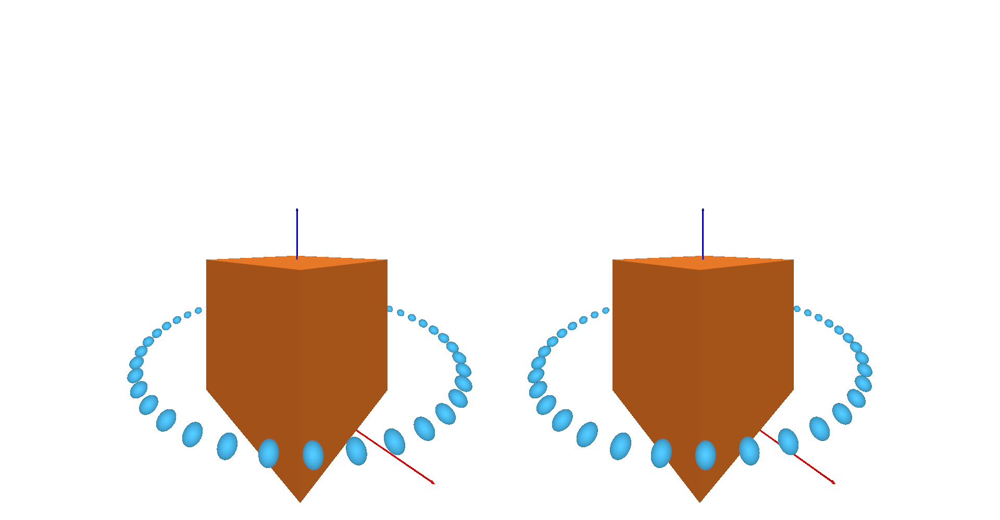
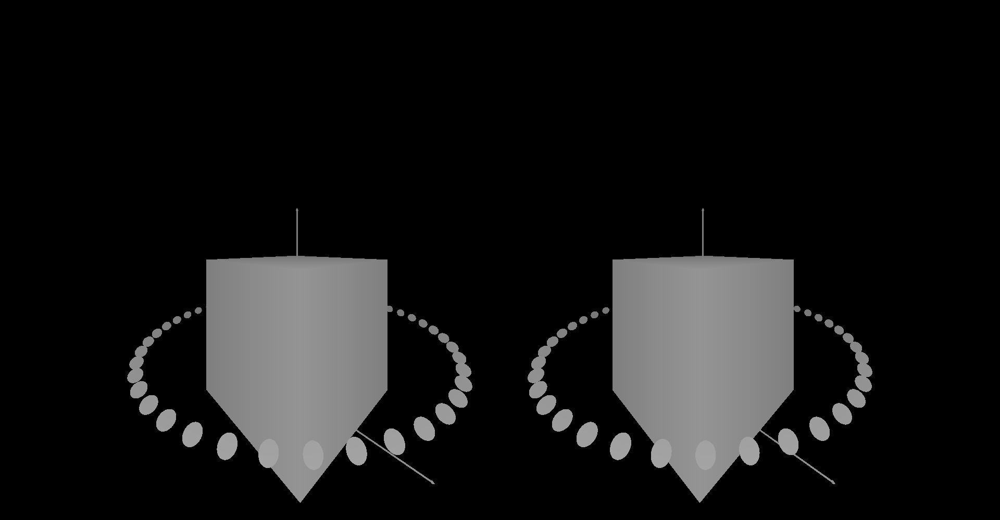
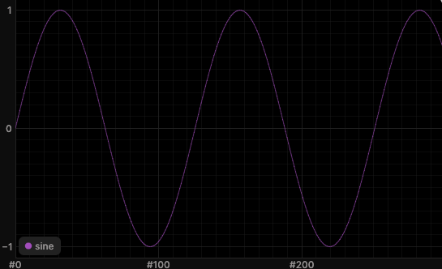
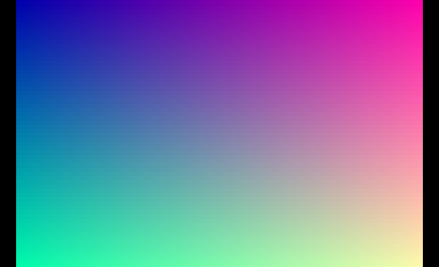
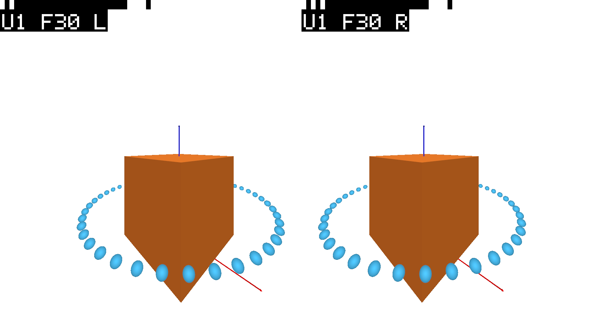
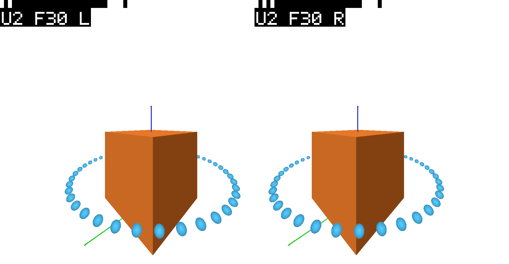

# qaros-rerun

The [Rerun](https://rerun.io) viewer (0.40.0) streaming its 3D view into AR headsets through [QAROS](https://www.quaternar.com/), QuaternAR's AR streaming runtime. The viewer renders the 3D view once per eye of every connected headset, with the eye poses and fields of view that headset asks for, and hands each eye to QAROS as color plus depth for QAROS to place in the room. 2D views (images, plots, maps) become QAROS GUI panels beside it. Applications change nothing: any Rerun SDK logs to this viewer on the standard port 9876.



*Rerun's structure from motion example, left eye of the headset stream on a Mac (image sink, head walking around the model, 60° view, transparent pixels shown dark), with the photo and the error plot as the GUI panels the viewer serves. The [demos](docs/demos.md) show how each one looks.*

## Quick start

On a Mac or Windows, with [Rust](https://rustup.rs) and [uv](https://docs.astral.sh/uv/), no headset needed:

```sh
git clone https://github.com/Quaternar/qaros-rerun && cd qaros-rerun
cargo build --release -p qaros-rerun
uv run demos/robot_arm/run.py
```

The first start fetches Rerun's example and records it once (a few minutes). Then the viewer opens with the demo playing, and its image sink writes what a simulated headset's eyes see to `out/headset/` as PNGs. On the PC that runs the QAROS Hub, `uv run demos\robot_arm\run.py -- --sink qaros --local-app --panels 0.0.0.0:9877` streams it to the headsets instead; the [integration guide](docs/integration-guide.md) takes you from there to your own data.

## What it is

The 3D view is rendered inside the viewer frame and handed over as RGBA8 color plus `f32` depth with the near and far planes used. Each user has a render stream of their own; a policy decides whom to render for (by default up to two users at a time), and users who leave are released. 2D views are cropped from the viewer's own UI and served to a small web page that a QAROS GUI panel opens.

This is a sample integration of QAROS through its public C API `qar-streaming-c`. The Rust binding (`qaros`), a stub of the runtime for tests (`qaros-stub`) and a test extension come from [github.com/Quaternar/qaros](https://github.com/Quaternar/qaros), pinned by git revision in `Cargo.toml`. The viewer builds, runs and is tested on macOS and Windows: on a Mac with the PNG image sink or against `qaros-stub` (the Vulkan path on MoltenVK), on Windows streaming on both paths against QAROS 0.9. It follows the QAROS API app contract (`--launched-by-qaros`), so the visualizer's Source Applications panel can start it.

## Requirements

- The Rust toolchain pinned in `rust-toolchain.toml` (Rust 1.96, Rerun 0.40.0's minimum, with clippy, rustfmt and the Windows target). With `rustup` installed, the first `cargo` command inside the repository fetches it.
- Git and network access on the first build, for crates.io and the `qaros` git dependency.
- On Windows: Visual Studio Build Tools 2022 with the "Desktop development with C++" workload.
- To stream to headsets: Windows with a QAROS installation (from [quaternar.com](https://www.quaternar.com/)) and a GPU with a Vulkan driver. Builds, tests and the image sink need no QAROS: the tests load `qaros-stub` instead.

## Build

```sh
cargo build --release -p qaros-rerun
```

The first build compiles Rerun and takes several minutes. The release build puts `qaros-rerun` and `log-test-scene` in `target/release/`; the commands below use the debug build (`cargo build -p qaros-rerun`) unless they say otherwise.

## Architecture



| Crate | What it holds |
| --- | --- |
| [`crates/xr-math`](crates/xr-math) | Pure math, no Rerun or QAROS dependency: `Pose`, `Fov` and `NearFar` mirroring `QarPose`, `QarFov` and `QarNearFar`; the per-eye `EyeCamera`; the off-axis projection decomposed into `re_renderer`'s symmetric perspective plus viewport transformation; reverse-Z to finite depth encodings; Rerun view coordinates to OpenXR room axes; app-volume placement with scale |
| [`crates/frame-sink`](crates/frame-sink) | The `FrameSink` trait (the seam), users (`UserRoster`, `RenderPolicy`, `MaxUsers`), the frame stamp, the PNG `ImageSink` with simulated users, scripted head motion; with `gpu`, `GpuFrameSink` for sinks whose textures the renderer draws into |
| [`crates/panel-server`](crates/panel-server) | Local HTTP server and page for 2D views as panels, a test-pattern producer |
| [`crates/qaros-sink`](crates/qaros-sink) | The QAROS side over the `qaros` crate: connect (load, rejoin or onboard, the session's adapter, app volume, peer update and render request subscriptions), `QarosSink` implementing `FrameSink` with one CPU render sender per user, the `UserEventSource` trait and `TargetPeers`, which finds the targets in the peer list, `QarosPanels` for GUI panels; with `vulkan`, `VulkanSink` with one Vulkan render sender per user; stub tests |
| [`crates/qaros-rerun`](crates/qaros-rerun) | The viewer binary, the headset renderer, panel capture, headless mode, and `log-test-scene`; the `qaros` feature (default on) adds `--sink qaros` |
| [`patches/re_view_spatial`](patches/re_view_spatial) | `re_view_spatial` 0.40.0 with a 3D view observer hook (pristine copy, then the patch) |
| [`patches/re_renderer`](patches/re_renderer) | `re_renderer` 0.40.0 with the picking layer's depth kept on the GPU for the Vulkan path (pristine copy, then the patch; one more line lets its shaders load from `patches/`) |

### The hook

The 3D view's draw data is what the eyes need, and Rerun 0.40.0 offers no public way to get it: a wrapper view class cannot reuse the `3D` identifier the spatial visualizers check for, and visualizers cannot see each other's output. The least invasive hook is a small patch to `re_view_spatial` (one new module and one call site): right before the 3D view queues its draw data into its own `ViewBuilder`, it hands the data to an optional observer, together with the view coordinates, scene bounds and desktop camera (`patches/re_view_spatial/src/view_3d_observer.rs`, call site in `src/ui_3d.rs`). While an observer is registered, the view also keeps encoded images and video frames that lie outside the desktop camera, which Rerun would otherwise skip (`src/eye.rs`). The workspace applies it with `[patch.crates-io]`.

Per viewer frame, the headset renderer then:

1. while the 3D view draws (the sink is lent to the UI pass), shows the frames that are complete, then asks the sink for the next frame of every user that has none in flight (two poses and fields of view each, per-eye resolution);
2. builds one `ViewBuilder` per eye of each of those frames from copies of the same draw data, with the decomposed off-axis projection of that frame's own pose and a full-eye picking layer for depth (`re_renderer` does not expose the main depth buffer); for a CPU sink also a screenshot readback for color and a readback of the picking depth, for a GPU sink neither (the patched `re_renderer` keeps the picking depth on the GPU, [docs/vulkan-path.md](docs/vulkan-path.md#why-the-extra-pass));
3. after the UI pass, draws and submits all eyes on the viewer's queue, so streaming does not depend on the desktop window being visible; for a GPU sink it also writes color and depth into the sink's textures and shows each frame right away;
4. collects finished readbacks and shows them through a CPU sink, and releases frames that could not be set up or whose readback did not arrive.

Every frame is keyed by user and a per-user frame id from the sink's request to `show_frame`, and every readback carries that key, so a user's frame is shown only with the pixels rendered for its own pose. Users render independently: a user whose readback is late does not hold up the others.

The sink lives with the viewer app on the UI thread and is passed to the renderer per call: the renderer is shared with the 3D view observer, which must be `Send + Sync`, while QAROS handles are bound to one thread. Pixels where nothing was drawn are made transparent from the depth coverage, so only Rerun's content reaches the room. The viewer repaints continuously while the sink is streaming, that is while at least one user is rendered, and behaves normally otherwise, repainting every 0.5 s to poll the peer list; the QAROS peer update and frame callbacks wake it from library threads.

### The seam

```rust
pub trait FrameSink {
    fn begin_frames(&mut self) -> Result<Vec<FrameRequest>, SinkError>;
    fn submit_view(&mut self, key: FrameKey, view_index: usize, image: EyeImage)
        -> Result<(), SinkError>;
    fn show_frame(&mut self, key: FrameKey, show: ShowInfo) -> Result<(), SinkError>;
    fn abandon_frame(&mut self, key: FrameKey);
    fn is_streaming(&self) -> bool;
    fn depth_range(&self) -> DepthRange;
}
```

`begin_frames` first applies user joins and leaves, then returns one request per rendered user without a frame in flight. `FrameRequest` carries the `FrameKey { user, frame_id }` (frame ids count per user from 0), two `ViewRequest { pose, fov }` (room-from-eye pose and OpenXR-style angles, like `QarPose` and `QarFov`) and the per-eye resolution. `EyeImage` is tightly packed RGBA8 color (sRGB) plus one `f32` per pixel in the sink's `DepthRange` encoding. `ShowInfo` is what `QarRenderFrameShow` carries: near/far in room meters and `depth_scale`.

### Coordinates and depth

- Rerun's world is placed in the room by `AppPlacement`: a volume pose, `app_pose` and `app_scale` as in QAROS app volumes, and the view's own coordinates (for example `RFU`, Z up) rotated onto the room's Y-up axes. Left-handed view coordinates are rejected. The eye is shrunk into Rerun-world units with the content, which keeps `view_from_world` rigid and every angle intact.
- With `--sink qaros`, the same `--origin`, `--yaw` and `--scale` define the app volume "rerun" (center, `app_pose`, `app_scale`). Stream poses arrive in the volume's app content space (header `b1338df`, L145-158): `--pose-space app` (default) maps them into the room with the volume's placement and hands near and far back in app units; `--pose-space room` uses the poses as they come and applies the placement here. Either way the renderer works in room space, and depth values are encoded from room meters.
- Depth goes out as D3D/OpenXR-style forward normalized depth with a finite far plane (0 at near, 1 at far, Rerun's background at far) and `depth_scale` 1.0. QAROS does not document its convention; reverse normalized and linear meters are one flag away (`--depth`). The reasoning, with QAROS line references, is in [`crates/xr-math/src/depth.rs`](crates/xr-math/src/depth.rs).

## Running on the Mac

```sh
cargo build -p qaros-rerun
./target/debug/qaros-rerun --headless 1600x1000 --out out/headset \
    --frames 240 --write-every 30 --panels 127.0.0.1:9877 &
./target/debug/log-test-scene 300
curl -s http://127.0.0.1:9877/views    # then open http://127.0.0.1:9877/views/<name>
```

Drop `--headless` for the normal desktop window. `./target/debug/qaros-rerun --help` lists the options: eye resolution, scripted motion (a walk around the scene, or standing still), simulated users, the frame stamp, world origin, scale and yaw in the room, near/far and depth encoding, panel address and capture interval, `--sink off` for a plain viewer.

Several simulated users, each with their own stream of PNGs and the frame stamp in every eye:

```sh
./target/release/qaros-rerun --headless 1600x1000 --users 2 --join-interval 30 \
    --frames 31 --write-every 30 --frame-stamp --out out/two-users --quit-when-done &
./target/release/log-test-scene 300
```

User k joins `--join-interval` viewer frames after user k-1 and leaves after `--frames` shown frames; users are spread evenly around the circle walk. `--max-users` (default 2) caps how many are rendered at once; a user over the cap waits for a free slot.

The QAROS sink runs on the Mac too, against `qaros-stub` (its simulated visualizer asks for a stream as soon as one is subscribed, with 64x64 views per eye). The stub is a dev-dependency of `qaros-sink`, so building that crate's tests builds it into `target/debug/deps/`:

```sh
cargo test -p qaros-sink --no-run
export QAROS_DLL="$(ls -t target/debug/deps/libqaros_stub-*.dylib | head -n 1)"
./target/debug/qaros-rerun --headless 1600x1000 --sink qaros --pairing-code ANY-CODE \
    --frames 150 --quit-when-done --panels 127.0.0.1:9877 &
./target/debug/log-test-scene 300
```

This loads the stub, onboards (the id lands in `qaros-rerun.onboarding-id.txt`, so the next start rejoins without a code), creates the app volume, finds the stub's visualizer in the peer list, creates its sender, streams 150 frames, opens a GUI panel per 2D view, and tears down in order.

With Homebrew's `vulkan-loader` and `molten-vk` and `DYLD_FALLBACK_LIBRARY_PATH=/opt/homebrew/lib`, the viewer also runs on wgpu's Vulkan backend (`--graphics-backend vulkan`) and on a Vulkan device it creates itself, on a chosen physical device with extra device extensions (`--vulkan-device`, `--vulkan-extension`), described in [docs/vulkan-device.md](docs/vulkan-device.md). On that device the QAROS sink renders straight into each user's Vulkan render sender images (`--sink qaros --qaros-graphics vulkan`, with `--launched-by-qaros` for QAROS's API app contract), tested against `qaros-stub` on MoltenVK: [docs/vulkan-path.md](docs/vulkan-path.md).

Two users against the stub, with a second headset joining after 20 shown frames and the visualizer leaving after 100, and the stub checking every shown frame's stamp against the frame its sender issued:

```sh
QAROS_STUB_SCENARIO="join:headset-b@20,leave:visualizer@100" QAROS_STUB_REPORT=out/stub-report.txt \
./target/release/qaros-rerun --headless 1280x800 --sink qaros --pairing-code ANY-CODE \
    --frame-stamp --frames 160 --quit-when-done &
./target/release/log-test-scene 300
grep -c '^paired' out/stub-report.txt; grep -c '^ERROR' out/stub-report.txt
```

The image sink writes per user (`<out>/user-<n>/`) and per shown frame (every n-th): `frame_NNNNN_color.png` (left and right eye side by side, transparent background), `frame_NNNNN_depth.png` (log-scaled depth, background black), and `frame_NNNNN.txt` with the user, poses, fields of view, near/far and depth encoding.

## Demos

Demos with real Rerun data start with one command each, for example `uv run demos/drone_lidar/run.py`; the list, what each shows and its data are in [docs/demos.md](docs/demos.md).

The mixer masks every stream to its app volume's box ([the mixer][MIXER] at `b1338df`), so content farther than half the volume size from `--center`, in room meters after `--scale`, is clipped in the headset. With the default `--volume-size 2,2,2` that is 1 m along each axis; a larger `--volume-size` or a smaller `--scale` keeps more of a scene.

[MIXER]: https://github.com/Quaternar/qaros/blob/b1338df/docs/website/docs/operator-guide/the-mixer.md "QAROS operator guide, The mixer: every stream is spatially masked to its volume's oriented bounding box"

## Evidence from a Mac

From a headless run of the included test scene (a 1 m cube on the ground, a ring of points, axes), with the head walking a circle of 1.6 m radius around the scene at 1.6 m eye height and a headset-like asymmetric field of view per eye:

| Frame 0, color | Frame 0, depth |
| --- | --- |
|  |  |
| Frame 30 (45° around the scene), color | Frame 30, depth |
|  |  |

The cube's front face measures 357 px wide in both eyes at 960x1000 per eye; the expected width from its angular size (1 m at 1.1 m, field of view in the frame metadata) is 358 px. The face's center sits at column 573 in the left eye and 386 in the right, against 573.8 and 386.2 expected from each eye's principal point and the interpupillary offset.

The near points look like ellipses stretched away from the image center. That is the rectilinear projection of a sphere seen off axis, elongated by 1/cos θ along the line to the principal point: the bottom sphere, 45° below the axis, measures 1.44 against 1.42 expected. Through the headset's optics they appear round.

2D views as served to panels (time series and image view, cropped from the viewer's UI):

 

### Two users, frame stamp on

Two simulated users on opposite sides of the scene, the second joining 30 viewer frames after the first, both at frame 30 (`docs/evidence/multi-user/`, written by the image sink; the `.txt` next to each PNG holds that frame's poses):

| User 1, frame 30 | User 2, frame 30 |
| --- | --- |
|  |  |

Each eye carries `U<user> F<frame> L|R` and the strip above it. Decoding the strips of every evidence PNG gives the frame id in its file name, left eye L and right eye R.

Against `qaros-stub` (the commands under "Running on the Mac"), the release build rendered the visualizer as user 1, admitted `headset-b` as user 2 when it joined, released user 1 when the visualizer left, and showed 160 frames with none abandoned; the stub matched the stamp of all 160 shown frames to the frame its sender issued, with no pairing or teardown errors (`docs/evidence/multi-user/stub-two-users-report.txt`, lines `paired ...`). That report was recorded with an earlier begin mode (`render_sender_begin_frame_async` in its call log); the viewer polls `qar_render_sender_try_begin_frame` (ADR-0039), and frame pairing does not depend on the begin mode.

### Stream rate per user

Shown frames per second for each user, release build, headless, the included test scene, Metal on an Apple M5 Pro, render and readback only: no QAROS encoding, no network, no headset. Every user is rendered every viewer frame from the same draw data; both users of a run reach the same rate. Ranges span repeated runs, measured on a shared machine; read the rates as lower bounds.

| Per-eye resolution | 1 user | 2 users, each |
| --- | --- | --- |
| 960x1000 | 58 to 61 | 34 to 44 |
| 1440x1500 | 31 to 33 | 17 to 27 |
| 1832x1920 | 24 to 31 | 15 to 20 |

Two users stay above 30 frames per second each at 960x1000 per eye; at 1440x1500 and above they do not on the Mac measured. Readbacks then take 3 to 4 viewer frames (begin to show 35 to 65 ms), so the rate on the CPU path is bound by GPU readback and the per-eye CPU conversion on the UI thread rather than by drawing. The Vulkan path has no readback ([docs/vulkan-path.md](docs/vulkan-path.md)).

## Tests

```sh
cargo test --workspace
cargo clippy --workspace --all-targets -- -D warnings
cargo clippy -p qaros-rerun --no-default-features --all-targets -- -D warnings
```

`qaros-sink` has unit tests for the pixel copy (BGRA swizzle, row pitch, view offsets, flipped views, native-endian depth floats, rejected sizes and formats) and for the layout check, and stub tests (`crates/qaros-sink/tests/stub.rs`) that load `qaros-stub` from the build directory: onboarding without and with a pairing code, the wake callback, sender creation from the request, frame begin, submit, show, abandon and the one-frame limit, two users joining at different times with their own senders, poses and frame ids, a third user waiting until one leaves and the departed user's sender released, a frame stamped with the wrong frame id caught by the stub, new panels waiting for a viewer near the volume and opening within reach of that viewer's head, a reattached panel left where the user put it, panels hidden on drop, rejoin with the stored id, app-space poses mapped into the room, and a teardown the stub records without ordering, pairing or leak errors.

`panel-server` runs the panel page's own script under Node with stand-ins for images and timers (`crates/panel-server/tests/page_retry.mjs`, from `cargo test` when `node` is on the path): retries back off while the server is gone and frames resume once it is back.

`frame-sink` tests the user roster (the maximum, waiting users admitted when one leaves, custom policies), the image sink with users joining at their tick and their own frame ids and directories, and the frame stamp (strip and text decode back to user, frame and eye at headset and stub resolutions, only the corner changes). `qaros-rerun` tests that each eye image carries the stamp of its own user, frame and eye, that readback identifiers and view builder ids differ per user, frame and eye, and the per-user statistics.

The math is tested in `xr-math` against fixed headset-like and strongly off-center fields of view: the decomposition equals an explicit off-axis matrix, a point straight ahead lands on each eye's principal point, a 1 m cube at 2 m has the expected angular size, scale does not change reported room depth, depth encodings round-trip. `qaros-rerun` checks the same decomposition against `re_renderer`'s own `Projection` and `RectTransform` matrices, so a change in either fails a test; a change in how `ViewBuilder` combines them would not.

## The QAROS sink

`--sink qaros` connects before the viewer opens, all on the UI thread (with `--decoupled-render`, on the render thread instead, `docs/decoupled-render.md`):

1. loads `qar-streaming-c` from `--qaros-library` or `QAROS_DLL`, else with the binding's default lookup (a runtime already loaded, one beside the executable, `QAROS_RUNTIME_DIR`, the installed QAROS from `HKLM\SOFTWARE\Quaternar\QAROS`, then `PATH`), with the runtime binaries from the same directory (`QAROS_RUNTIME_DIR` overrides);
2. rejoins with the id in `--onboarding-id-file` (default `qaros-rerun.onboarding-id.txt`), or onboards with `--pairing-code` and stores the new id (with `--launched-by-qaros`, the launch invite from stdin; with `--local-app`, as a local app of the Hub on this PC), then reads the session's adapter (`qar_session_get_graphics_device_id`), on which `--qaros-graphics vulkan` (the default on Windows; `cpu` is the default elsewhere) creates the viewer's device;
3. gets or creates the app volume "rerun" (`--volume-name`, `--volume-size`, placement from `--origin`, `--yaw`, `--scale`); the demos name theirs `rerun-<demo>`, since two viewers asking for one name get one volume and one render stream. The volume's label for people is `--display-name` (default "Rerun", the demos use "Rerun robot arm" and so on), and the viewer's peer is "<display name> viewer". On Stop (a QAROS Stop, Ctrl+C, Ctrl+Break or a closed console) the viewer lets its senders' begin-frame waits end (at most 500 ms), drops the senders, hides its panels, closes the volume, leaves the session and ends the process without unloading QAROS (ADR-0035); a second Ctrl+C ends it at once;
4. subscribes to peer updates, then to render stream requests; the callbacks forward into channels and wake the viewer.

Users are the targets in the peer list, as the header's "Basic flow" at `b1338df` describes: a peer for which `qar_peer_spec_is_target_app` is true and whose app state is running (headset, Android streamer, visualizer). `TargetPeers` lists the peers once and then follows every peer update; a peer that stops running or leaves the list has left, and so has a user whose stream reports closed. A target asks for content only once a sender attached it to the app volume, so the viewer does not wait for render requests; a request from an unlisted peer still adds it. `TargetPeers` sits behind the `UserEventSource` trait. The `RenderPolicy` decides whom to render for; the default `MaxUsers` renders up to `--max-users` (default 2). Senders are created for every joined target at once, requesters first, and the first to arrive take the slots; the others wait and are tried again when a slot frees. A target whose creation timed out is held back for 10 minutes, also in later runs, and retried about once a minute; the viewer keeps these peers in `qaros-rerun.unanswered-peers.txt` next to the onboarding id file. A user who leaves is released: their open frame is dropped, and their sender once its begin-frame wait has ended.

Poses: the stream's view poses are in the app volume's app content space, in app units (header L145-158), and `--pose-space app` (the default) maps them into the room with the volume's placement; near and far go back to QAROS in app units, room meters divided by the app scale. `--pose-space room` uses the poses as they come and reports room meters.

On the CPU path (`--qaros-graphics cpu`), per viewer frame, `QarosSink` gives every rendered user a CPU render sender of their own (created with a 10 s timeout; a target that does not answer is retried later), bound to the volume, with both eyes' color side by side in texture 0 and both eyes' depth in texture 1 (BGRA8 by default, D32 depth). For each user without an open frame it polls `qar_render_sender_try_begin_frame` once per viewer frame, the only begin mode on both paths (ADR-0039); once delivered, the two view poses and fields of view become that user's frame request. Each eye is written into the rectangles the frame reports (row pitch, flips, BGRA swizzle or RGBA copy, `f32` depth), and the frame is shown with the near and far planes used, in the poses' units. Frame ids count the frames each user's sender delivered, so `show_frame` presents exactly the frame whose pose the eyes were rendered with. The per-eye resolution comes from the negotiated layout.

With `--panels`, a GUI panel opens for every 2D view the panel server publishes: 0.45 m wide with the view's aspect, navigated to `<base>/views/<name>`. The Hub owns a panel's place once the panel exists: it keeps the pose the panel was created with, or wherever a user moved it, across runs, and ignores later pose calls. So a new panel is created at its final place, within reach of the first viewer whose head is within 4 m of the app volume's centre on the floor plane (a Display Receiver's camera across the room does not count): on an arc 0.8 m from the head (measured on the floor plane), starting 0.25 m to the right of the gaze and going right, 0.1 m apart along the arc, top edges 0.1 m below the eyes, each upright and facing the head. The head is midway between that viewer's eyes, in room space, levelled to its heading. Until such a viewer streams, a view without a panel waits; later viewers change nothing, and panels created later join the same row. A panel an earlier run left is reattached where it is; close the panels in the Hub Display to have the next run create them afresh within reach. Each pose is the panel's top-edge midpoint, with the panel's -Z front facing the viewer, as the `b1338df` header defines panel space (ADR-0049). The base is `--panel-base-url`, else `http://` plus the `--panels` address with `0.0.0.0` replaced by this machine's LAN IPv4 address (the default route's local address, else the first interface address that is neither loopback nor link-local, else `127.0.0.1`); the log names the choice. Headsets on the LAN can load the pages whether they or the Hub fetch them; pass `--panel-base-url` when the log names the wrong network. Panels are never closed at Stop: they are hidden (`--panels-at-stop keep` leaves them showing) and stay in the session. A view's name, and so its panel's common name and URL, is the same on every run, so the next start reattaches to its panels, shows them again, and navigates one only when the panel server's address changed; panels of this volume for views no longer published are recognised by display name and hidden. A reattached panel whose page asks the panel server for nothing 10 s after the run saw the panels' browser running (a user stream started, or another view page asked) is taken for a page that failed to load while no viewer ran (white) and loaded again once at the same URL; `--dead-panels leave` turns that off.

## Run on Windows against QAROS

On the PC that runs the QAROS Hub, with the Hub running, point `QAROS_DLL` at the `qar-streaming-c.dll` in the `bin` directory of the QAROS runtime, then start the viewer as a local app of the Hub and log the test scene from a second terminal:

```powershell
cargo build --release -p qaros-rerun
$env:QAROS_DLL = "C:\path\to\qaros\bin\qar-streaming-c.dll"
.\target\release\qaros-rerun.exe --sink qaros --local-app --panels 0.0.0.0:9877
.\target\release\log-test-scene.exe 600    # second terminal
```

On its first start the Hub asks a person at the PC to allow the viewer. Instead of `--local-app`, `--pairing-code <PAIRING-CODE>` joins with the Hub's current pairing code, and `--launched-by-qaros` lets the visualizer's Source Applications panel start the viewer. Open the visualizer or a headset's player app to see the scene: every running target app gets a render stream of its own. On Windows the Vulkan path is the default; `--qaros-graphics cpu` selects the CPU path. The [integration guide](docs/integration-guide.md) covers the QAROS runtime, the firewall, placing your own data in the app volume, and what to try when frames look wrong (`--depth`, `--pose-space`, `--color-format`).

## Decoupled render loop

`--decoupled-render` (experimental, off by default) draws the eyes on a render thread of their own, from the last scene the UI thread finished, with fresh head poses. Head motion then stays smooth while a slow scene updates at its own rate. With the QAROS Vulkan path it needs a headless viewer (`--headless WxH`, or `--launched-by-qaros` without `--window`). Design and measurements: [docs/decoupled-render.md](docs/decoupled-render.md).

## Documentation

| Document | What it covers |
| --- | --- |
| [docs/INSTALLATION.md](docs/INSTALLATION.md) | Prerequisites on Mac and Windows, build, tests and a first run |
| [docs/integration-guide.md](docs/integration-guide.md) | From a build to your own Rerun data in a QAROS headset; options and troubleshooting |
| [docs/vulkan-path.md](docs/vulkan-path.md) | The QAROS Vulkan path: startup order, one frame, the hand-over, depth |
| [docs/vulkan-device.md](docs/vulkan-device.md) | The Vulkan device the viewer creates, on the Mac through MoltenVK and on Windows |
| [docs/decoupled-render.md](docs/decoupled-render.md) | The decoupled render loop |
| [docs/demos.md](docs/demos.md) | Demo launchers, what each demo shows and its data |
| [docs/decisions/](docs/decisions/README.md) | Architecture decision records |

## License

MIT, see [LICENSE](LICENSE). The vendored Rerun crates in `patches/` (`re_renderer`, `re_view_spatial`) keep Rerun's own license, MIT OR Apache-2.0, with its license files in each crate's directory.
