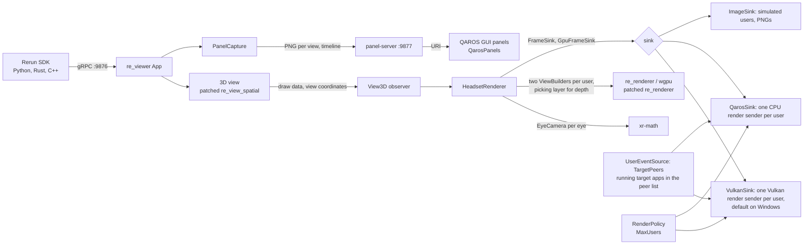

# qaros-rerun

Your [Rerun](https://rerun.io) data in the room, in AR glasses, for everyone wearing them.

`qaros-rerun` is the Rerun viewer (0.40.0) with a second output: [QAROS](https://www.quaternar.com/), QuaternAR's AR streaming runtime. Put on a headset and the 3D view stands on the table in front of you, at a size you can walk around. A point cloud, a robot arm or a flight path stays where it is while you lean in or step to the side.

- **Stereo 3D, per person.** Every headset gets its own stream, rendered from its own head pose, as color plus depth, so QAROS can place it in the room and keep it steady as you move.
- **2D views as panels.** Rerun's images, plots and maps open as panels next to the scene, placed by your headset. The Hub keeps them where you leave them, across runs.
- **A timeline in your hand.** A slider panel opens in front of you: drag it with a finger to scrub the recording, tap Play to resume. It follows the desktop viewer's time, and the desktop follows it.
- **No change to your code.** Any Rerun SDK (Python, Rust, C++) logs to this viewer on the standard port 9876.


*Rerun's structure from motion example as a headset's left eye sees it, with the photo and the error plot as panels. The [demos](docs/demos/README.md) show the others.*

It is also a worked example of bringing an existing desktop renderer to QAROS: [the integration pattern](docs/architecture.md#the-integration-pattern). For the Rerun team: [two small patches we would like to upstream](docs/for-rerun.md).

## Requirements

- Windows with a QAROS installation (from [quaternar.com](https://www.quaternar.com/)) and a GPU with a Vulkan driver.
- [Rust](https://rustup.rs): the toolchain pinned in `rust-toolchain.toml` (Rust 1.96) is fetched by the first `cargo` command in the repository.
- Visual Studio Build Tools 2022 with the "Desktop development with C++" workload.
- [uv](https://docs.astral.sh/uv/) for the demos, and network access on the first build.

Step by step, with checks: [docs/INSTALLATION.md](docs/INSTALLATION.md).

## Build

```powershell
git clone https://github.com/Quaternar/qaros-rerun; cd qaros-rerun
cargo build --release -p qaros-rerun
```

The first build compiles Rerun and takes several minutes.

## Run a demo

On the PC that runs the QAROS Hub, with the Hub running, in PowerShell:

```powershell
$env:QAROS_DLL = "C:\path\to\qaros\bin\qar-streaming-c.dll"
uv run demos/structure_from_motion/run.py -- --sink qaros --local-app --panels 0.0.0.0:9877
```

- On its first start the Hub asks a person at the PC to allow the viewer.
- The first start of a demo downloads its data and records it once (a few minutes).
- Open the visualizer or a headset's player app to see the scene. Every running target gets a render stream of its own; up to two users are rendered at once by default.
- With `--panels`, the 2D views open as GUI panels within reach of the first headset near the scene, and a timeline panel opens 0.5 m in front of it, 0.2 m below eye level. Drag its slider to scrub the recording, tap Play to resume; it follows the desktop time slider too.
- The Hub keeps a panel's place across runs. Close the panels in the Hub Display to have the next run open them in front of you again.

The demos are [structure from motion](docs/demos/structure-from-motion.md), [drone lidar](docs/demos/drone-lidar.md), [air traffic](docs/demos/air-traffic.md) and [robot arm](docs/demos/robot-arm.md); each page shows what you see and where the data comes from.

## Your own data

Start the viewer on its own, then log from any Rerun SDK to port 9876 as usual:

```powershell
.\target\release\qaros-rerun.exe --sink qaros --local-app --panels 0.0.0.0:9877
.\target\release\log-test-scene.exe 600    # second terminal: a 1 m cube, points, axes
```

`--origin`, `--yaw`, `--scale` and `--volume-size` place your data in the room; the mixer clips content outside the app volume. Instead of `--local-app`, `--pairing-code <PAIRING-CODE>` joins with the Hub's pairing code, and `--launched-by-qaros` lets the visualizer's Source Applications panel start the viewer. The Vulkan path is the default; `--qaros-graphics cpu` selects the CPU path. `qaros-rerun.exe --help` lists every option. The [integration guide](docs/integration-guide.md) covers the QAROS runtime, the firewall, placement, and what to try when frames look wrong (`--depth`, `--pose-space`, `--color-format`).

## How it works



A small patch to Rerun's 3D view hands its draw data to the headset renderer, which draws it once per eye of every user with that user's pose and field of view, and passes color and depth to QAROS through its public C API `qar-streaming-c`. Details: [docs/architecture.md](docs/architecture.md).

| Directory | What it holds |
| --- | --- |
| [`crates/qaros-rerun`](crates/qaros-rerun) | The viewer binary: headset renderer, panel capture, the timeline, `log-test-scene` |
| [`crates/qaros-sink`](crates/qaros-sink) | The QAROS side: connect, app volume, users from the peer list, CPU and Vulkan render senders, GUI panels |
| [`crates/panel-server`](crates/panel-server) | The local web server and pages behind the panels, including the timeline panel |
| [`crates/frame-sink`](crates/frame-sink) | The `FrameSink` seam, users and render policy, the frame stamp, the PNG image sink |
| [`crates/xr-math`](crates/xr-math) | Poses, fields of view, off-axis projection, depth encodings, room placement |
| [`patches/`](patches) | `re_view_spatial` and `re_renderer` 0.40.0 with small patches (pristine copy, then the patch) |
| [`demos/`](demos) | One-command demos with real Rerun data |
| [`docs/`](docs) | Guides, design notes and architecture decision records |

The Rust binding (`qaros`), the stub runtime for tests (`qaros-stub`) and a test extension come from [github.com/Quaternar/qaros](https://github.com/Quaternar/qaros), pinned by git revision in `Cargo.toml`.

## Tests

```powershell
cargo test --workspace
cargo clippy --workspace --all-targets -- -D warnings
```

The tests load `qaros-stub` instead of QAROS, so they need no Hub and no headset. What they cover: [docs/architecture.md](docs/architecture.md#tests).

## Documentation

| Document | What it covers |
| --- | --- |
| [docs/INSTALLATION.md](docs/INSTALLATION.md) | Prerequisites, build, tests and a first run |
| [docs/integration-guide.md](docs/integration-guide.md) | From a build to your own Rerun data in a QAROS headset; options and troubleshooting |
| [docs/demos/](docs/demos/README.md) | The demos: what each shows, how to run it, its panels and its data |
| [docs/architecture.md](docs/architecture.md) | The integration pattern, the 3D view hook, the sink seam, coordinates and depth, the QAROS sink and panels |
| [docs/for-rerun.md](docs/for-rerun.md) | For the Rerun team: the two patches to Rerun crates, what they enable, and an upstream API |
| [docs/vulkan-path.md](docs/vulkan-path.md) | The QAROS Vulkan path: startup order, one frame, the hand-over, depth |
| [docs/vulkan-device.md](docs/vulkan-device.md) | The Vulkan device the viewer creates |
| [docs/decoupled-render.md](docs/decoupled-render.md) | The experimental decoupled render loop (`--decoupled-render`) |
| [docs/decisions/](docs/decisions/README.md) | Architecture decision records |

The viewer also builds and runs on a Mac, without QAROS: with a PNG image sink or against `qaros-stub`, for development and tests. See [docs/mac.md](docs/mac.md).

## License

MIT, see [LICENSE](LICENSE). The vendored Rerun crates in `patches/` (`re_renderer`, `re_view_spatial`) keep Rerun's own license, MIT OR Apache-2.0, with its license files in each crate's directory.
