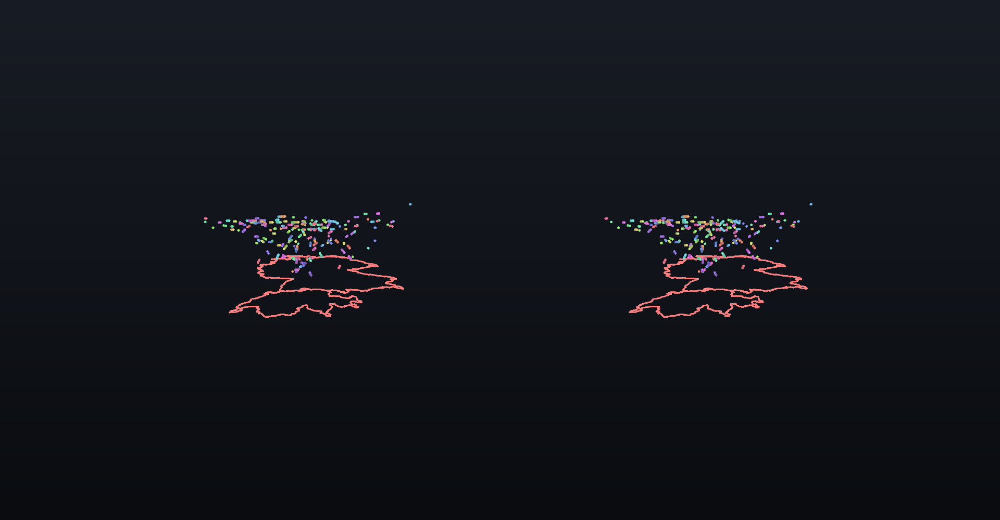
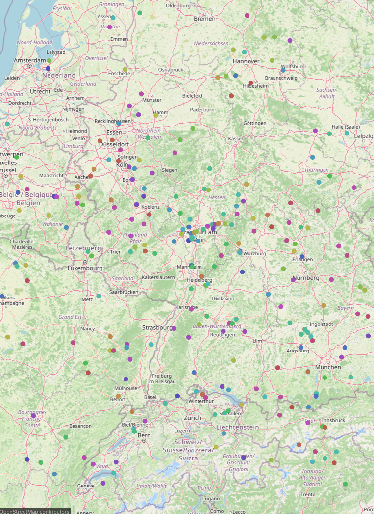

# Air traffic

Rerun's `air_traffic_data` example on its 10-minute dataset: ADS-B aircraft positions over Germany, Switzerland and the surrounding region, above the region outlines.



*Left and right eye of a headset frame, composited on a dark background where the stream is transparent.*

## What you see

- Each dot is an aircraft with a trail of its last minute of flight. Its height is its altitude, exaggerated 20x (the example uses 10x), so cruising aircraft fly about 0.4 m above the outlines.
- Each aircraft has a light colour of its own: see-through glasses add light to the room, so dark colours would barely show.
- The red lines are the NUTS region outlines.
- The **map panel** shows the same aircraft on OpenStreetMap.
- Walk around the table: from the side, the traffic separates by altitude.



## What it shows about QAROS

Geospatial data at the scale of a region, on a table: a whole airspace in 2.4 m, with the familiar 2D map next to it. The 3D view gives what the map cannot (altitude, separation, climb and descent), and the map panel keeps everyone oriented.

## Run it

On the Hub PC, from the repository root:

```powershell
uv run demos/air_traffic/run.py -- --sink qaros --local-app --panels
```

The first start downloads the aircraft data (2.7 MB) and the region outlines (30 MB) and records them once, which takes a few minutes; later starts replay the cached recording in seconds without network. Ten minutes of traffic play at 10x, so one loop is a minute. The map panel loads OpenStreetMap tiles and needs internet; the 3D view does not.

## Panels

- The map panel opens within reach of the first headset near the scene, to the right of the gaze.
- The timeline panel opens in front of you: drag to any moment of the ten minutes, tap Play to resume.

## Placement

Centered on the traffic (`--center 900000,5520000,120000`) at `--scale 1.8e-6`, in a 2.4 m app volume (`--volume-size 2.4,2.4,2.4`); the region outlines reach about 1.1 m north of the center. North is up in both the 3D view and the map.

## Tuning

`AIR_TRAFFIC_TRAIL_SECONDS` (default 60) sets the trail length. Every frame re-queries each aircraft's trail, so shorter trails (30) are lighter and longer ones (120) heavier.

## If something looks wrong

- The map panel is grey: no internet. The 3D view is unaffected.
- Aircraft look cluttered or the frame rate is low: shorten the trails (above).

## Data

ADS-B data that [INVOLI](https://www.involi.com) provided for Rerun's `air_traffic_data` example, hosted by Rerun ([involi_demo_set_1_10min.zip](https://storage.googleapis.com/rerun-example-datasets/involi/involi_demo_set_1_10min.zip)); the example does not state a licence for it. Region outlines from Eurostat GISCO, NUTS 2021 ([ref-nuts-2021-01m.json.zip](https://gisco-services.ec.europa.eu/distribution/v2/nuts/download/ref-nuts-2021-01m.json.zip)), under the copyright notice of [Eurostat GISCO](https://ec.europa.eu/eurostat/web/gisco/geodata/statistical-units/territorial-units-statistics). Map tiles © [OpenStreetMap contributors](https://www.openstreetmap.org/copyright).
