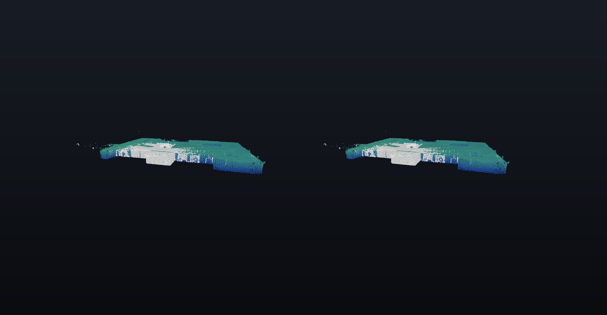

# Drone lidar

Rerun's `drone_lidar` example: a drone flight through a basement with its indoor lidar, 18.7 million points over 401 s.



*Left and right eye of a headset frame, composited on a dark background where the stream is transparent.*

## What you see

- The **white points** are the lidar scans of the last 5 s of flight, so the measured patch moves through the rooms with the drone.
- The **orange trail** is the drone's path over the last minute.
- The **dim blue to green backdrop** is the whole scan, one point in 60, coloured by height. The launcher adds it for the glasses; it is not part of the example.
- The basement fits on the table, about 1.7 m by 1.1 m. Lean in to follow the trail through a doorway, or step back to see the floor plan.

## What it shows about QAROS

Survey and inspection data is large and spatial. This demo streams a building-scale lidar scan, shrunk to a tabletop model, with a moving window over millions of points. Placed low and seen from above, the floor plan reads like a physical model on the table.

## Run it

On the Hub PC, from the repository root:

```powershell
uv run demos/drone_lidar/run.py -- --sink qaros --local-app --panels 0.0.0.0:9877
```

The first start downloads the dataset (157 MB) and records it once, which takes a few minutes; later starts replay the cached recording in seconds without network. The flight plays at 6x, so one loop is a little over a minute.

## Panels

The demo has no 2D views. With `--panels` you get the timeline panel: drag to fly the drone to any moment of the flight, tap Play to resume.

## Placement

The middle of the scanned basement (`--center -33.5,-4.1,1.4`) at 0.024 m per meter of basement (`--scale 0.024`), 0.25 m above and 1.7 m in front of the room origin, lower than the other demos so you look down onto the floor plan.

## Tuning

The lidar window is re-queried every frame while playing, so its length sets the frame rate.

- `DRONE_LIDAR_WINDOW_SECONDS` (default 5): seconds of lidar shown; 3 is lighter, 10 a wider sweep.
- `DRONE_LIDAR_PATH_SECONDS` (default 60): length of the flight path trail; `inf` shows the whole path, which costs more the further the flight goes.

Set them in the environment before `uv run`.

## If something looks wrong

- The model looks frozen: the first seconds after start are the recording loading; playback starts by itself.
- Low frame rate: shorten the lidar window (above).

## Data

Indoor lidar and trajectory that [Flyability](https://www.flyability.com) provided for Rerun's `drone_lidar` example, hosted by Rerun ([livemap.las.zip](https://storage.googleapis.com/rerun-example-datasets/flyability/basement/livemap.las.zip), [livetraj.csv](https://storage.googleapis.com/rerun-example-datasets/flyability/basement/livetraj.csv)). The example does not state a licence for it.
