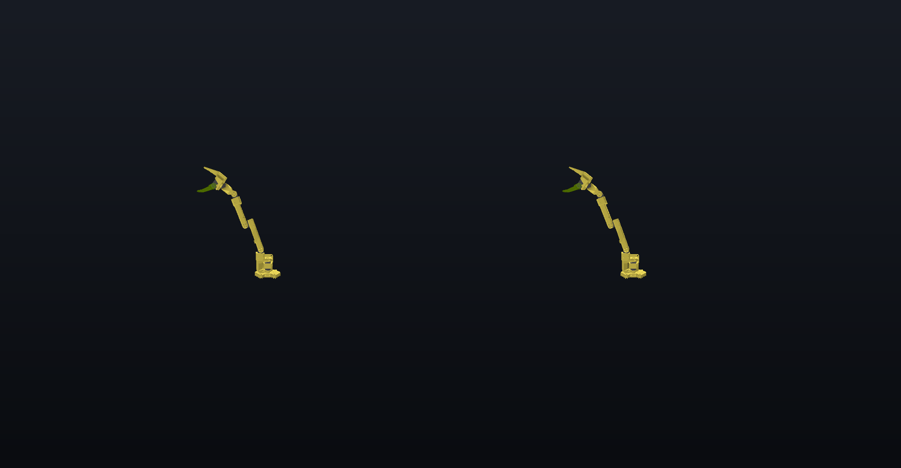

# Robot arm

Rerun's `animated_urdf` example: an SO-ARM100 robot arm loaded from its URDF, moving through its joint ranges.



*Left and right eye of a headset frame, composited on a dark background where the stream is transparent.*

## What you see

- The arm is loaded straight from its URDF, the standard robot description format, with its visual meshes; the collision meshes are hidden.
- Each joint follows joint angles the example generates and logs over time.
- The arm stands on the table at twice its real size, its sweep about 1.4 m wide. Walk around it to see the joints from the side.

## What it shows about QAROS

Any robot described in URDF can stand in the room as a digital twin, driven by logged or live joint data. This is the lightest demo, and the quickest check that a new Hub, headset and network are set up right.

## Run it

On the Hub PC, from the repository root:

```powershell
uv run demos/robot_arm/run.py -- --sink qaros --local-app --panels 0.0.0.0:9877
```

The first start downloads the URDF and meshes (2.9 MB) and records them once, which takes a few minutes, most of it setting up the Python environment; later starts replay the cached recording in seconds without network.

## Panels

The demo has no 2D views. With `--panels` you get the timeline panel: drag to pose the arm at any moment of its motion, tap Play to resume.

## Placement

The middle of the arm's sweep (`--center 0,-0.03,0.23`) at `--scale 2.0`, 0.65 m above and 1.7 m in front of the room origin, so its base stays just above a table with the origin marker on it. Pass `-- --scale 1.0` for real size; a later `--scale` overrides the launcher's.

## Data

The SO-ARM100 URDF and meshes from [TheRobotStudio](https://github.com/TheRobotStudio/SO-ARM100), Apache-2.0, as shipped with Rerun's `animated_urdf` example (`examples/rust/animated_urdf/data`, with its `LICENSE`); the joint angles are generated by the example.
