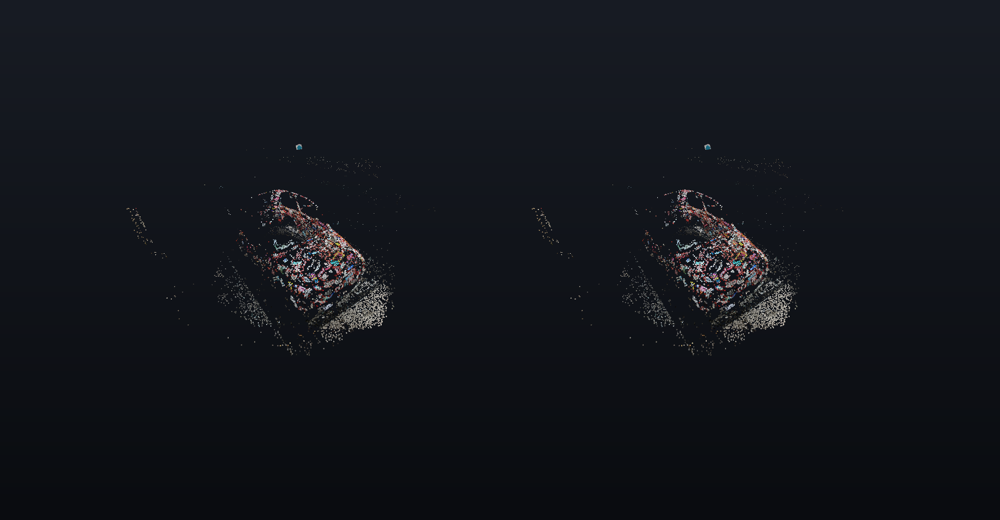
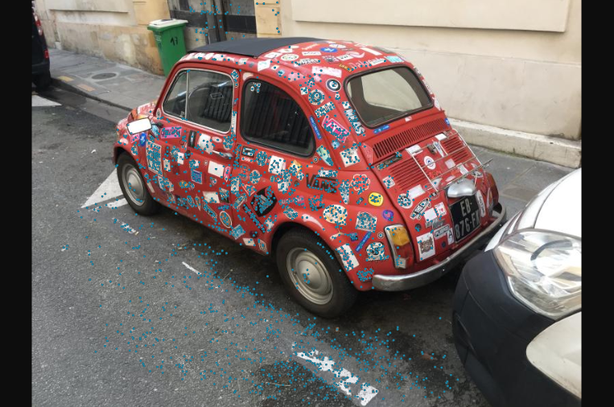
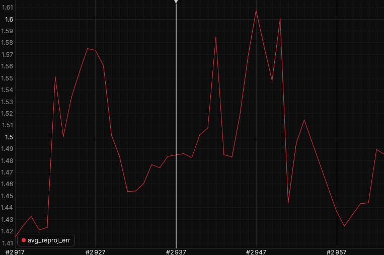

# Structure from motion

Rerun's `structure_from_motion` example on the `colmap_fiat` dataset: a COLMAP reconstruction of a car, replayed photo by photo.



*Left and right eye of a headset frame. Where the stream is transparent, the room shows through; here it is composited on a dark background.*

## What you see

- Each photo adds a camera frustum to the 3D view, and the features it shares with earlier photos become 3D points. The point cloud accumulates over all past photos, so the car builds up as the camera moves around it.
- The **camera panel** shows the current photo with its detected keypoints.
- The **reprojection error panel** plots the average error per photo.
- The car is about 1 m long, standing in front of you at the table. Walk around it: the model stays in place, and each eye sees it from its own position.

| Camera panel | Reprojection error panel |
| --- | --- |
|  |  |

## What it shows about QAROS

A 3D reconstruction is hard to judge on a flat screen and easy to judge when you can walk around it. This demo puts a growing point cloud, the camera poses that produced it, and the 2D detail for each photo (image and error plot) in one shared space. Two people in headsets see the same model, each from where they stand.

## Run it

On the Hub PC, from the repository root:

```powershell
uv run demos/structure_from_motion/run.py -- --sink qaros --local-app --panels
```

The first start downloads the dataset (80 MB) and records it once, which takes a few minutes; later starts replay the cached recording in seconds without network. The 51 photos play at 0.8 per second, so one loop is about a minute.

## Panels

- The camera and reprojection error panels open within reach of the first headset near the scene, to the right of the gaze.
- The timeline panel opens in front of you: drag to step through the reconstruction photo by photo, tap Play to resume.

## Placement

The point cloud is centered on the median of the reconstructed points (`--center -0.7,1.3,1.5`), at 0.18 of its reconstructed size (`--scale 0.18`), 0.5 m above and 1.7 m in front of the room origin. Point radius 0.012.

## If something looks wrong

- Nothing in the volume: on the first start after a `--record` the recording is still loading; wait for "playing in a loop" in the console.
- The layout on the PC looks like Rerun's default: close the viewer and run the command again; the launcher stops leftover viewers itself.

## Data

The `colmap_fiat` reconstruction that Rerun hosts for its `structure_from_motion` example ([colmap_fiat.zip](https://storage.googleapis.com/rerun-example-datasets/colmap/colmap_fiat.zip)). The example does not state a licence for it.
